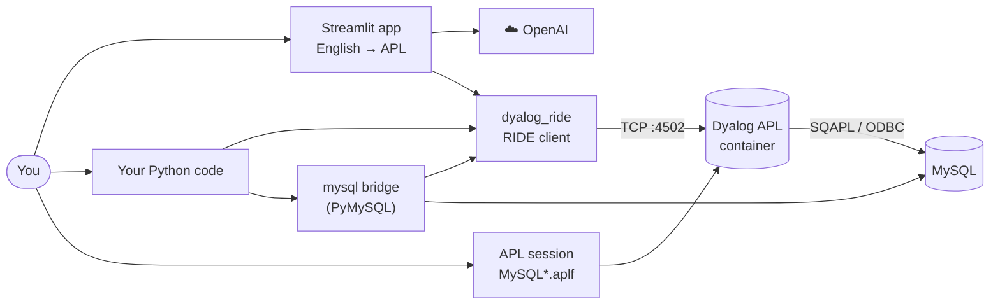

# Learn APL with Dyalog

*Thinking in arrays with [Dyalog APL](https://www.dyalog.com): tutorials,
runnable scripts, a `dyalog` command-line tool, and integrations with
Python, OpenAI, Streamlit and MySQL.*

```apl
      +/⍳100                       ⍝ sum of 1 to 100
5050
      (2=+⌿0=(⍳20)∘.|⍳20)/⍳20       ⍝ primes up to 20
2 3 5 7 11 13 17 19
```

## What's inside

| | |
| --- | --- |
| 📚 **[Tutorials](tutorials/README.md)** | 12 lessons from first steps to classes and control structures, each with exercises and solutions. Every output shown was produced by Dyalog 21. |
| 📜 **[Sample scripts](sample-scripts/README.md)** | Small runnable programs: primes, strings, statistics, Game of Life, a CSV report… |
| 🗂️ **[File types](sample-scripts/file-types/README.md)** | One example of each Dyalog file type: `.apls .aplf .aplo .apln .aplc .apli .apla .dyapp .dws` |
| ⌨️ **[`dyalog` command](install/dyalog/README.md#the-dyalog-command)** | Run Dyalog and APL files from any folder, on any Mac (including Intel), using a container |
| 🧪 **[Testing](testing/README.md)** | A small APL test framework: write `*_test.aplf` files, run `dyalog test` |
| 🔌 **[Integrations](integrations/README.md)** | Drive Dyalog from Python, ask questions in plain English (OpenAI + Streamlit), read and write MySQL from Python or from APL itself |

## Quick start

### 1. Get Dyalog running

| Your setup | Do this |
| --- | --- |
| **Intel Mac** (Dyalog 21 for macOS is Apple Silicon only) | `install/dyalog/install-cli.sh`, then `dyalog` |
| **Apple Silicon Mac** | install the app: `install/dyalog/mac.sh install` ([guide](install/dyalog/mac.md)) |
| **Docker or Podman**, any OS | `install/dyalog/podman.sh run` or `docker.sh run` ([guide](install/dyalog/README.md)) |

The `dyalog` command uses Podman (or Docker). If neither is installed, run
`dyalog setup` first.

### 2. Check it works

```sh
dyalog                 # opens APL in your terminal
```

```apl
      ⍳10
1 2 3 4 5 6 7 8 9 10
      )off
```

### 3. Start learning

Open [tutorials/00-getting-started](tutorials/00-getting-started/README.md),
or run a sample:

```sh
dyalog sample-scripts/08-life.apls       # Conway's Game of Life in one line of APL
```

### Prefer an editor window?

RIDE is Dyalog's IDE. Serve the interpreter, then connect RIDE to it:

```sh
dyalog ride                          # serves RIDE on localhost:4502
install/ride/install.sh --start      # builds and starts RIDE (or use a RIDE release)
```

In RIDE, choose **Connect** → `localhost:4502`. Type glyphs with the backtick
prefix: `` `i `` gives `⍳`, `` `r `` gives `⍴`.

## The `dyalog` command

```sh
dyalog                    # APL session; the current folder is available at /app
dyalog hello.apls         # run a script top to bottom, then exit (exit code 4 on error)
dyalog MyFn.aplf          # session with a function loaded (runs it if it takes no arguments)
dyalog Stats.apln         # session with a namespace loaded (calls its Run)
dyalog Grid.apla          # display an array-notation file
dyalog app.dyapp          # boot an app definition (Load … / Run … lines)
dyalog demo.dws           # open a saved workspace
dyalog test               # run all *_test.aplf tests here (see testing/)
dyalog ride               # serve RIDE on port 4502
dyalog help
```

> **In scripts, only `⎕←` lines print.** Write `⎕←'hello'`, not just
> `'hello'`. See [writing scripts](sample-scripts/README.md#writing-your-own-scripts).

## Integrations



| Integration | What it does | Start here |
| --- | --- | --- |
| **dyalog_ride** | Python client for a live Dyalog session over the RIDE protocol. Keeps state between calls, reports errors, handles timeouts and multi-line code. | [README](integrations/dyalog_ride/README.md) |
| **streamlit_app** | Web UI: describe what you want in English, and an OpenAI model writes the APL, runs it, fixes errors and explains it. Also has a plain APL REPL with a glyph keyboard. | [README](integrations/streamlit_app/README.md) |
| **mysql** (Python) | Load query results into APL as column vectors, analyse them, and write results back as tables | [README](integrations/mysql/README.md) |
| **mysql/apl** (pure APL) | `MySQLConnect`, `MySQLQuery`, `MySQLExec`, `MySQLSave` as `.aplf` functions, using Dyalog's SQAPL over ODBC | [README](integrations/mysql/apl/README.md) |

```sh
# one-time Python setup for the integrations
uv venv .venv
uv pip install --python .venv/bin/python -r integrations/streamlit_app/requirements.txt -r integrations/mysql/requirements.txt

dyalog ride                                                   # terminal 1
.venv/bin/streamlit run integrations/streamlit_app/app.py     # terminal 2 (needs OPENAI_API_KEY)
```

## Repository layout

```
tutorials/              12 lessons (00–11) with exercises: start here
sample-scripts/         runnable .apls programs, plus poem.txt and sales.csv data
  file-types/           one example of every Dyalog file type (with tests/)
testing/                the test framework (Tester.apln) and an example
integrations/
  dyalog_ride/          Python RIDE-protocol client (stdlib only)
  streamlit_app/        English → APL web app (OpenAI) + REPL
  mysql/                MySQL ↔ APL from Python
    apl/                MySQL ↔ APL from APL (SQAPL), plus Dockerfile for the ODBC driver
install/
  dyalog/               ways to run Dyalog: the `dyalog` command, Mac app, Docker, Podman
  ride/                 build and run the RIDE editor from source
```

## Requirements

- **Podman or Docker** for the `dyalog` command and containers (`dyalog setup` installs Podman with Homebrew)
- **Python 3.10+** and [uv](https://docs.astral.sh/uv/) (or pip) for the integrations
- **Node.js 18** only if you build RIDE from source
- An **OpenAI API key** only for the Streamlit chat tab

## Good to know

- **Intel Macs:** the macOS app for Dyalog 21 is ARM only and fails with
  "Bad CPU type". Use the `dyalog` command, which runs the Linux x86_64
  build natively in a container.
- **Your files in the container:** the folder you run `dyalog` from is
  mounted at `/app`. Anything saved outside `/app` disappears when you quit.
- **Index origin:** everything here uses Dyalog's default `⎕IO←1`, so
  counting starts at 1.
- **Licence:** Dyalog is free for personal, non-commercial use. See
  <https://www.dyalog.com/prices-and-licences.htm>.

## Resources

- [Dyalog documentation](https://docs.dyalog.com)
- [APL Wiki](https://aplwiki.com) and its [list of glyphs](https://aplwiki.com/wiki/List_of_language_elements)
- [TryAPL](https://tryapl.org): APL in the browser, nothing to install
- [Learning APL](https://xpqz.github.io/learnapl): a free online book
- [APL Cart](https://aplcart.info): a searchable library of idioms
- [APL Problem Solving Competition](https://www.dyalogaplcompetition.com): practice problems
- [APL Orchard](https://apl.chat): the community chat
- [RIDE on GitHub](https://github.com/dyalog/ride)
