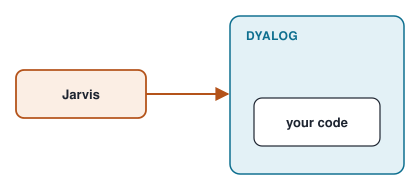

# Architecture

How every part of this repo connects to Dyalog.

![The main Dyalog interpreter in a container. The terminal connects to its session; RIDE and the Python dyalog_ride client connect to its RIDE server on TCP 4502; HTTP clients call Jarvis, which runs inside the workspace and calls your code; SQAPL reaches MySQL over ODBC; a Kafka client talks to a Kafka broker in its own container. Bottom left, a separate Jupyter container: the browser talks to JupyterLab on port 8888, whose kernel runs its own Dyalog over RIDE. Bottom, dcf-tools starts a separate Dyalog container for each command, with .dcf folders mounted read-only, and reads back JSON or text. Top left, code-map reads APL source as text and needs no Dyalog.](architecture.svg)

The big shaded box is the **main Dyalog interpreter**. Everything outside it is
a separate program on your Mac or in another container. Orange marks the HTTP
path. Bottom left, **Jupyter** runs in its own container with **its own
Dyalog**: your browser talks to JupyterLab on port 8888, and the kernel drives
that Dyalog over the RIDE protocol. Along the bottom, **dcf-tools** starts a
short-lived Dyalog container for each command (see
[one container per command](#a-fourth-pattern-one-container-per-command)).
Top left, **code-map** reads APL source as plain text and needs no Dyalog at
all.

## The core idea: one interpreter, three doors

There's a single Dyalog interpreter, running in a container. Programs on your
Mac reach it through one of three doors:

| Door | Who uses it | Protocol |
| --- | --- | --- |
| **Session** | the terminal: `dyalog`, `dyalog FILE.apls`, `dyalog test` | stdin / stdout (scripts use `dyalogscript`) |
| **RIDE server** | the RIDE editor, and Python's `dyalog_ride` client | RIDE protocol over TCP **4502** |
| **Jarvis** | any HTTP client: curl, Python, JavaScript, a browser | HTTP **8080** |

Whichever door is used, the APL runs in the same place: the **workspace**,
where everything that's loaded lives.

**Jupyter is the exception:** it doesn't use these doors. The notebooks run in
a separate container whose kernel starts and drives its own Dyalog, so a
notebook's variables live in that interpreter, not the main one.

## A fourth pattern: one container per command

[dcf-tools](../dcf-tools/README.md) (the component file viewer, diff and SQL
generator) uses none of the three doors. For every request, Python starts a
new container running `dyalogscript dcf.apls …`, with the folders it needs
mounted **read-only**, and reads back JSON or text. Then the container exits.

```
dcf.py / viewer ── podman run … dyalogscript dcf.apls diff OLD NEW ──► Dyalog (fresh)
       ▲                                                                 │ reads .dcf
       └───────────────────────── JSON / text ◄──────────────────────────┘ then exits
```

`dyalog FILE.apls` and `dyalog test` work the same way: a script runs, then
the container is gone.

| | Live session (RIDE) | One container per command | Jarvis (HTTP) |
| --- | --- | --- | --- |
| State between calls | kept: variables survive | none: every call starts fresh | kept |
| Start-up cost | once | about 1 second per call | once |
| Files it can see | what's mounted at `/app` | only the folders it was given, read-only | what's mounted at `/app` |
| Left running | the container | nothing | the container |
| Used by | RIDE, APL Playground, MySQL bridge | dcf-tools, `dyalog FILE.apls`, `dyalog test` | the HTTP API |

### Choosing a way in

- **A live session over RIDE** when the tool is interactive and builds up
  state, like a REPL or a chat that defines functions and uses them later.
- **One container per command** for batch jobs and tools over files. It's
  simple, can't leave anything behind, can be given read-only access, and a
  crash affects one call only. The cost is a second of start-up per call, so
  cache results (the dcf viewer caches by file time and size).
- **Jarvis** when other programs call APL as a service: many callers, a
  stable API, and no RIDE client needed.
- **No Dyalog at all** when reading the source is enough:
  [code-map](../sample-scripts/component-files/README.md#a-map-of-the-code)
  parses APL as text to show which code touches which file.

## Inside vs outside

| Inside the workspace (APL code) | Outside (separate programs) |
| --- | --- |
| your code: `.aplf`, `.apln`, `.aplc` | RIDE (editor window) |
| **Jarvis**: the HTTP server, written in APL | terminal, `dyalog` command |
| **SQAPL**: database access over ODBC | Python: `dyalog_ride`, Streamlit app, MySQL bridge |
| **Kafka client**: librdkafka + `Kafka.apln` | the Kafka broker (its own container) |
| **Tester**: the test framework | curl, browsers, other apps |
| **DCF.apln**: reads and compares component files (dcf-tools) | MySQL, OpenAI |
| | dcf-tools (`dcf.py`, viewer), code-map |

### A common mix-up: Jarvis is inside

RIDE and Jarvis can look alike, since both let something "talk to Dyalog". But
they sit in different places:

| Wrong | Right |
| :---: | :---: |
|  |  |
| Jarvis as a separate program | the HTTP client is outside; Jarvis is APL inside Dyalog, calling your code |

- **RIDE** really is a separate program. It connects to the interpreter
  over the RIDE port.
- **Jarvis** is a file of APL (`Jarvis.dyalog`) loaded *into* the workspace
  next to your functions. When a request arrives on port 8080, Jarvis calls
  your function with the JSON body as `⍵`.

## Every way in

| Way in | Start it with | Door · protocol | Use it for | Docs |
| --- | --- | --- | --- | --- |
| Terminal session | `dyalog` | session · stdin/stdout | typing APL | [install/dyalog](../install/dyalog/README.md#the-dyalog-command) |
| Script | `dyalog hello.apls` | `dyalogscript` · runs, then exits | programs (only `⎕←` prints) | [sample-scripts](../sample-scripts/README.md) |
| Tests | `dyalog test` | `dyalogscript` + Tester | checking `*_test.aplf` | [testing](../testing/README.md) |
| RIDE | `dyalog ride`, then RIDE → Connect | RIDE server · TCP 4502 | editing and debugging | [install/ride](../install/ride/README.md) |
| Python tools | `dyalog_client.py` | RIDE server · TCP 4502 | Streamlit + OpenAI app, MySQL bridge | [dyalog_ride](../integrations/dyalog_ride/README.md) |
| Jupyter notebooks | `install/jupyter/jupyter.sh start` | the kernel starts its own Dyalog in that container and talks RIDE to it | learning in runnable notebooks | [notebooks](../notebooks/README.md) |
| HTTP API | `integrations/jarvis/serve.sh` | Jarvis · HTTP 8080 | other apps calling your functions | [jarvis](../integrations/jarvis/README.md) |
| MySQL from APL | `]load …/MySQL*.aplf` | SQAPL → ODBC → MySQL :3307 | queries from inside APL | [mysql/apl](../integrations/mysql/apl/README.md) |
| Kafka from APL | `integrations/kafka/kafka.sh run …` | Kafka client → broker :19092 | producing and consuming event streams | [kafka](../integrations/kafka/README.md) |
| Component file tools | `python3 dcf-tools/dcf.py …`, or the viewer | one container per command · read-only mounts | viewing, diffing, suggesting SQL tables | [dcf-tools](../dcf-tools/README.md) |
| Code map | `python3 sample-scripts/component-files/code-map.py` | none: reads source as text | which code touches which file | [code-map](../sample-scripts/component-files/README.md#a-map-of-the-code) |

## Good to know

- **One door per container.** A container started with `dyalog` has a
  terminal session; one started with `dyalog ride` serves the RIDE port. To
  use RIDE *and* the Python tools together, start it with `dyalog ride`:
  they share that port.
- **Files come in through `/app`.** The folder you run `dyalog` from (or the
  repo, for the scripts here) is mounted at `/app`. Code is loaded from there
  with `]load`, `⎕FIX` or `LOAD=`.
- **Kafka runs in a second container.** The broker and Dyalog share a
  private container network (`apl-kafka`). Dyalog needs the `dyalog-kafka`
  image, which adds Dyalog's Kafka library.
- **SQAPL needs an extra driver.** The APL MySQL functions need the
  `dyalog-mysql` image, which adds the ODBC driver
  (see [mysql/apl](../integrations/mysql/apl/README.md)).
- **Short-lived containers see only what they're given.** dcf-tools mounts
  each folder it needs read-only, and maps container paths back to your own
  paths in messages. With a native Dyalog, `DYALOGSCRIPT=…` skips the
  container entirely.
- **The container runs in Podman's Linux VM.** On a Mac, containers run
  inside a small Linux virtual machine. That's how the Linux build of
  Dyalog runs natively on an Intel Mac.

## Other languages

Python, C#, C and C++ can all work with Dyalog: Python as a separate program
over RIDE or HTTP, and .NET or C code inside Dyalog via `⎕USING` and `⎕NA`.
See [other-languages.md](other-languages.md).

## Files in this folder

| File | What |
| --- | --- |
| [other-languages.md](other-languages.md) | how Python, C#, C and C++ connect to Dyalog |
| [architecture.svg](architecture.svg) | the main diagram (adapts to GitHub's light and dark themes) |
| [jarvis-sketch.svg](jarvis-sketch.svg), [jarvis-actual.svg](jarvis-actual.svg) | the Jarvis comparison |

The SVGs are hand-drawn: plain text files with boxes, lines and labels. Edit
the coordinates directly to change them.
