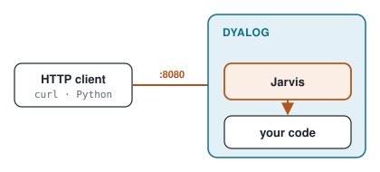

# Architecture

How every part of this repo connects to Dyalog.

The shaded box is the **one Dyalog interpreter**. Everything outside it is a
separate program on your Mac. Orange marks the HTTP path.

## The core idea: one interpreter, three doors

There's a single Dyalog interpreter, running in a container. Programs on your
Mac reach it through one of three doors:

| Door | Who uses it | Protocol |
| --- | --- | --- |
| **Session** | the terminal: `dyalog`, `dyalog FILE.apls`, `dyalog test` | stdin / stdout (scripts use `dyalogscript`) |
| **RIDE server** | the RIDE editor, and Python's `dyalog_ride` client | RIDE protocol over TCP **4502** |
| **Jarvis** | any HTTP client: curl, Python, JavaScript, a browser | HTTP **8080** |

Whichever door is used, the APL runs in the same place: the **workspace**,
where everything that's loaded lives.

## Inside vs outside

| Inside the workspace (APL code) | Outside (separate programs) |
| --- | --- |
| your code: `.aplf`, `.apln`, `.aplc` | RIDE (editor window) |
| **Jarvis**: the HTTP server, written in APL | terminal, `dyalog` command |
| **SQAPL**: database access over ODBC | Python: `dyalog_ride`, Streamlit app, MySQL bridge |
| **Tester**: the test framework | curl, browsers, other apps |
| | MySQL, OpenAI |

### A common mix-up: Jarvis is inside

RIDE and Jarvis can look alike, since both let something "talk to Dyalog". But
they sit in different places:

| Wrong | Right |
| :---: | :---: |
|  |  |
| Jarvis as a separate program | the HTTP client is outside; Jarvis is APL inside Dyalog, calling your code |

- **RIDE** really is a separate program. It connects to the interpreter
  over the RIDE port.
- **Jarvis** is a file of APL (`Jarvis.dyalog`) loaded *into* the workspace
  next to your functions. When a request arrives on port 8080, Jarvis calls
  your function with the JSON body as `⍵`.

## Every way in

| Way in | Start it with | Door · protocol | Use it for | Docs |
| --- | --- | --- | --- | --- |
| Terminal session | `dyalog` | session · stdin/stdout | typing APL | [install/dyalog](../install/dyalog/README.md#the-dyalog-command) |
| Script | `dyalog hello.apls` | `dyalogscript` · runs, then exits | programs (only `⎕←` prints) | [sample-scripts](../sample-scripts/README.md) |
| Tests | `dyalog test` | `dyalogscript` + Tester | checking `*_test.aplf` | [testing](../testing/README.md) |
| RIDE | `dyalog ride`, then RIDE → Connect | RIDE server · TCP 4502 | editing and debugging | [install/ride](../install/ride/README.md) |
| Python tools | `dyalog_client.py` | RIDE server · TCP 4502 | Streamlit + OpenAI app, MySQL bridge | [dyalog_ride](../integrations/dyalog_ride/README.md) |
| HTTP API | `integrations/jarvis/serve.sh` | Jarvis · HTTP 8080 | other apps calling your functions | [jarvis](../integrations/jarvis/README.md) |
| MySQL from APL | `]load …/MySQL*.aplf` | SQAPL → ODBC → MySQL :3307 | queries from inside APL | [mysql/apl](../integrations/mysql/apl/README.md) |

## Good to know

- **One door per container.** A container started with `dyalog` has a
  terminal session; one started with `dyalog ride` serves the RIDE port. To
  use RIDE *and* the Python tools together, start it with `dyalog ride`:
  they share that port.
- **Files come in through `/app`.** The folder you run `dyalog` from (or the
  repo, for the scripts here) is mounted at `/app`. Code is loaded from there
  with `]load`, `⎕FIX` or `LOAD=`.
- **SQAPL needs an extra driver.** The APL MySQL functions need the
  `dyalog-mysql` image, which adds the ODBC driver
  (see [mysql/apl](../integrations/mysql/apl/README.md)).
- **The container runs in Podman's Linux VM.** On a Mac, containers run
  inside a small Linux virtual machine. That's how the Linux build of
  Dyalog runs natively on an Intel Mac.

## Files in this folder

| File | What |
| --- | --- |
| [architecture.svg](architecture.svg) | the main diagram (adapts to GitHub's light and dark themes) |
| [jarvis-sketch.svg](jarvis-sketch.svg), [jarvis-actual.svg](jarvis-actual.svg) | the Jarvis comparison |

The SVGs are hand-drawn: plain text files with boxes, lines and labels. Edit
the coordinates directly to change them.
