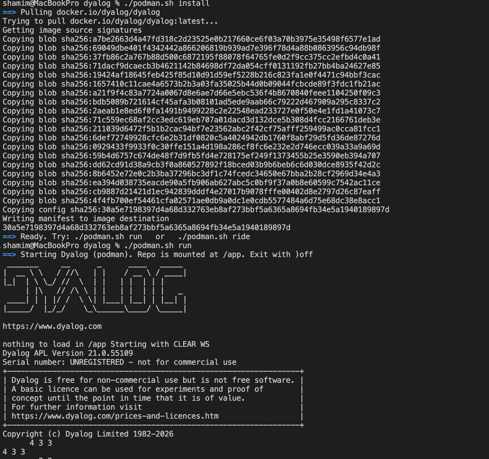

# Installing Dyalog APL

RIDE (in [`../ride`](../ride)) is only the IDE. It connects to a Dyalog APL
**interpreter**, which has to be installed separately. Pick one option:

| Option | Best for | Guide | Script |
| --- | --- | --- | --- |
| Native macOS app | Day-to-day learning on a Mac; RIDE is bundled | [mac.md](mac.md) | [mac.sh](mac.sh) |
| Docker | Throwaway, reproducible interpreter | [docker.md](docker.md) | [docker.sh](docker.sh) |
| Podman | Same as Docker, but daemonless / rootless | [podman.md](podman.md) | [podman.sh](podman.sh) |

## Scripts

Each script has the same subcommands:

```sh
./mac.sh    install | check | alias | run | ride
./docker.sh install | pull | run | ride
./podman.sh install | pull | run | ride
```

- `install` installs or checks the prerequisites. The macOS app needs a free
  registration to download, so `mac.sh install` opens the download page.
- `run` starts an APL session in your terminal.
- `ride` starts the interpreter serving RIDE on `localhost:4502`. Then open
  RIDE and choose **Connect**.

Example: `./podman.sh install`, then `./podman.sh run`:



`docker.sh` and `podman.sh` both use [container.sh](container.sh). They mount
the repo root at `/app` inside the container. Set `RIDE_PORT` to use a
different port.

All three options can be used with the RIDE you built from source. The
interpreter listens on a port (we use `4502`), and RIDE connects to it.

## Quick check

Once a session is running, try:

```apl
⍳10
+/⍳100
```

You should get `1 2 3 4 5 6 7 8 9 10` and `5050`.

## Licence

Dyalog is free for personal, non-commercial use. Commercial use needs a paid
licence. See <https://www.dyalog.com/prices-and-licences.htm>.
