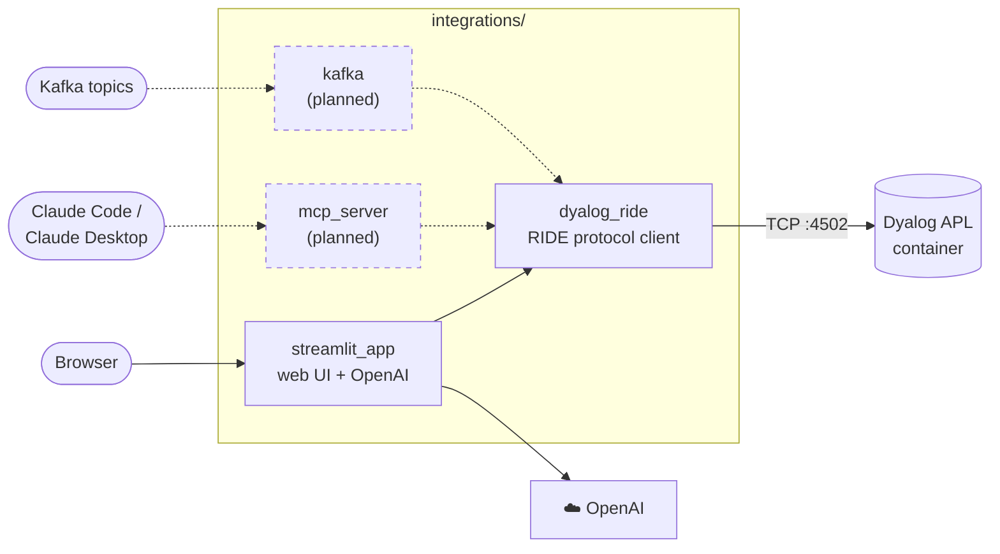

# Integrations

Ways to connect Dyalog APL to other systems.

| Folder | What it is | Status |
| --- | --- | --- |
| [dyalog_ride/](dyalog_ride/README.md) | Python client for a live Dyalog session over the RIDE protocol. The others build on it. | ready |
| [streamlit_app/](streamlit_app/README.md) | Web UI: describe what you want in English, and an OpenAI model writes and runs the APL. Also has a plain APL REPL. | ready |
| `mcp_server/` | MCP tools (`apl_eval`, `apl_load`, `apl_reset`) for Claude Code, Claude Desktop and other clients | planned |
| `kafka/` | Run APL on messages from Kafka topics | planned |

## Architecture

Every integration reaches Dyalog through the same client, `dyalog_ride`.
Dashed boxes are planned.

## Conventions

- One folder per integration, named in `snake_case` so it can be imported
  as a Python package.
- Each folder has its own `README.md` covering how to run it.
- Integrations talk to Dyalog through `dyalog_ride`. They don't open their
  own connections.
- Dyalog runs in a container. Mount the repo read-only (`:ro`) whenever an
  integration runs code that you didn't write yourself (for example, code
  from an AI or a message queue).
