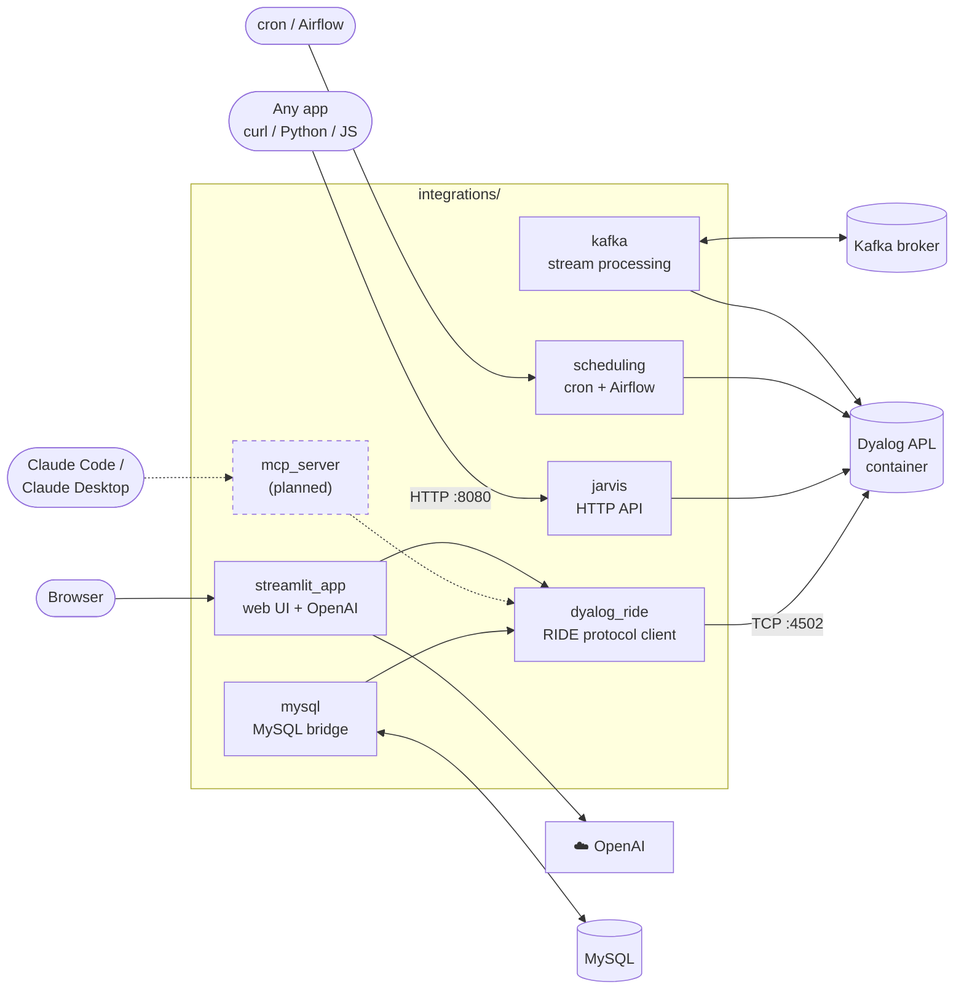

# Integrations

Ways to connect Dyalog APL to other systems.

| Folder | What it is | Status |
| --- | --- | --- |
| [dyalog_ride/](dyalog_ride/README.md) | Python client for a live Dyalog session over the RIDE protocol. The Python integrations build on it. | ready |
| [streamlit_app/](streamlit_app/README.md) | Web UI: describe what you want in English, and an OpenAI model writes and runs the APL. Also has a plain APL REPL. | ready |
| [mysql/](mysql/README.md) | Load MySQL query results into APL, analyse them, and write results back as tables. Use it from Python, or straight from APL with `.aplf` functions ([mysql/apl](mysql/apl/README.md)). | ready |
| [jarvis/](jarvis/README.md) | HTTP JSON API: APL functions become `POST` endpoints any language can call (Jarvis) | ready |
| `mcp_server/` | MCP tools (`apl_eval`, `apl_load`, `apl_reset`) for Claude Code, Claude Desktop and other clients | planned |
| [kafka/](kafka/README.md) | Produce and consume Kafka messages from APL; a stream processor keeping running totals with `⌸` | ready |
| [scheduling/](scheduling/README.md) | Run APL scripts on a schedule: a cron wrapper (logs, locking, exit codes) and a local Airflow with Dyalog inside it | ready |

## Architecture

Integrations that drive Dyalog *from outside* (Python, Streamlit) share one
client, `dyalog_ride`. Jarvis, Kafka and the APL MySQL functions run *inside* Dyalog. Scheduling
runs scripts with `dyalogscript`, in the Dyalog container (cron) or inside the Airflow image.
Dashed boxes are planned.

## Conventions

- One folder per integration, named in `snake_case` so it can be imported
  as a Python package.
- Each folder has its own `README.md` covering how to run it.
- Python integrations talk to Dyalog through `dyalog_ride`, rather than
  opening their own connections.
- Dyalog runs in a container. Mount the repo read-only (`:ro`) whenever an
  integration runs code that you didn't write yourself (for example, code
  from an AI or a message queue).
