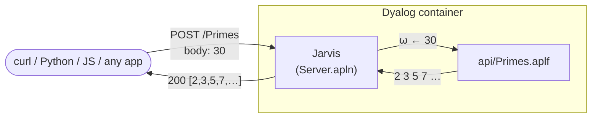

# HTTP API with Jarvis

Turn APL functions into a JSON web API, so **any language** can call them:
curl, Python, JavaScript, Excel, a phone app…

```
$ curl -s -X POST localhost:8080/Primes -H 'Content-Type: application/json' -d 30
[2,3,5,7,11,13,17,19,23,29]
```

## What is Jarvis?

[Jarvis](https://github.com/Dyalog/Jarvis) is Dyalog's open-source (MIT) web
service framework, written in APL. In **JSON mode**, each function becomes an
endpoint:

- `POST /Name` calls the APL function `Name`.
- The JSON request body arrives as `⍵`. Objects become namespaces, and lists
  become vectors.
- The function's result is sent back as JSON.

It runs inside Dyalog, using Conga, Dyalog's networking library. There's no
Python or Node server in between.



## Run it

```sh
integrations/jarvis/serve.sh          # port 8080; or: serve.sh 9000
```

```
Jarvis is serving on port 8080. Endpoints (POST, JSON body):
  /Hello
  /Primes
  /Sort
  /Stats
  /Sum
  /WordCount
```

Then, in another terminal:

```sh
integrations/jarvis/examples/curl.sh                  # every endpoint with curl
python3 integrations/jarvis/examples/client.py        # Python (also checks every answer)
node integrations/jarvis/examples/client.mjs          # JavaScript (Node 18+)
```

Open <http://localhost:8080> in a browser for Jarvis's built-in test page.
Stop the server with **Ctrl+C**.

## Endpoints

| Endpoint | Body | Response | Shows |
| --- | --- | --- | --- |
| `/Hello` | `{"name":"Ann"}` | `{"message":"Hello, Ann!"}` | object in, object out |
| `/Sum` | `[1,2,3,4]` | `10` | the simplest possible endpoint: `+/⍵` |
| `/Sort` | `["pear","apple"]` | `["apple","pear"]` | lists of text |
| `/Primes` | `30` | `[2,3,5,…,29]` | validation: bad input → **400** with `{"error":…}` |
| `/Stats` | `[2,4,4,4,5,5,7,9]` | `{"count":8,"mean":5,"median":4.5,…}` | returning several values as an object |
| `/WordCount` | `{"text":"…","top":3}` | `[{"word":"the","count":3},…]` | a list of objects; an optional field |

Every response above was checked against the running server. `Primes 1000000`
returns all 78,498 primes in about 50 ms.

## Write your own endpoint

Add a file to [api/](api). The file name is the endpoint name:

```apl
⍝ api/Double.aplf   →   POST /Double   body: [1,2,3]   →   [2,4,6]
 Double←{⍵×2}
```

Restart `serve.sh` and it's live. To answer **400 Bad Request** for bad
input, make the function ambivalent and use Jarvis's request object, which
arrives as the left argument:

```apl
 r←{req}Half n
 :If ~{0::0 ⋄ ∧/⍵=⍵+0}n                   ⍝ not numbers?
     :If 0≠⎕NC'req' ⋄ req.Fail 400 ⋄ :EndIf ⍝ only when called by Jarvis
     r←⎕NS ⍬ ⋄ r.error←'send numbers' ⋄ :Return
 :EndIf
 r←n÷2
```

The `0≠⎕NC'req'` check means the same function also works without a left
argument, which makes it easy to test.

### What clients get back

| Situation | HTTP status |
| --- | --- |
| success | **200** + your result as JSON |
| you called `req.Fail 400` | **400** + whatever you returned (e.g. `{"error":"…"}`) |
| unknown endpoint | **404** |
| an APL error in your function | **500** + the error name (e.g. `DOMAIN ERROR`) |
| body isn't valid JSON | **400** |

## Test endpoints without a server

Endpoints are plain APL functions, so [`dyalog test`](../../testing/README.md)
works on them directly. The tests are in [api/tests/](api/tests):

```sh
dyalog test integrations/jarvis
```

```
/app/integrations/jarvis/api/tests/
  ✅ Hello_test  (3 checks)
  ✅ Primes_test  (7 checks)
  ...
6 tests: 6 passed, 0 failed, 0 errors
```

To test the 400 path, [Primes_test](api/tests/Primes_test.aplf) uses a tiny
stand-in for Jarvis's request object, a "mock" that records the status:

```apl
 req←⎕NS ⍬ ⋄ req.status←200 ⋄ req.⎕FX 'Fail s' 'status←s'
 {}req Primes 1
 400 ExpectEq req.status
```

## Files

| File | Purpose |
| --- | --- |
| [serve.sh](serve.sh) | starts the server in a container (Dyalog with `LOAD=Server.apln`) |
| [Server.apln](Server.apln) | loads Jarvis and `api/*.aplf`, then starts serving |
| [api/](api) | the endpoints, one function per file |
| [api/tests/](api/tests) | tests for the endpoints |
| [examples/](examples) | curl, Python and JavaScript clients |
| [vendor/](vendor) | Jarvis v1.23.1, unmodified, with its MIT licence |

## Things worth knowing

- **Only `api/*.aplf` is served.** Jarvis would load subfolders too, so
  `Server.apln` loads just the top level of `api/` into a namespace. That
  way `api/tests/` is never exposed. Keep helper functions somewhere else,
  because every function in that namespace is a public endpoint.
- **Local only by default.** The server listens on `127.0.0.1`, so only your
  computer can reach it. There's no login. To share it on your network, use
  `HOST=0.0.0.0 integrations/jarvis/serve.sh`, and only on a network you
  trust. Jarvis has settings for authentication and HTTPS if you need them.
- **POST only.** Endpoints don't accept GET by default (Jarvis's
  `AllowGETs` setting).
- **Why a session and not a script:** `serve.sh` runs Dyalog as a session
  with `LOAD=Server.apln`, not as a `dyalogscript`. A script only prints its
  output when it ends, and a server never ends, so you'd see nothing. And
  the server loop runs in the main thread (`DYALOG_JARVIS_THREAD←0`): in a
  background thread, it stopped answering after the first request.
- **More Jarvis features** (REST mode, sessions, authentication, HTTPS,
  CORS, WebSockets) are covered in the
  [Jarvis documentation](https://dyalog.github.io/Jarvis/).
