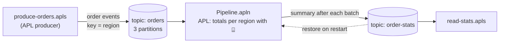

# Kafka from APL

Produce and consume [Kafka](https://kafka.apache.org/) messages straight
from APL, and process a live stream of events with array operations.

```apl
      p←Kafka.Producer 'apl-kafka:19092'
      p Kafka.Send 'orders' order 'North'          ⍝ topic value key
      c←Kafka.Consumer 'apl-kafka:19092' 'my-group' 'orders'
      msgs←Kafka.Poll c
      msgs.data.region                             ⍝ JSON values arrive parsed
```

## What is Kafka?

Kafka is a streaming platform. Programs **produce** messages (events like
"order placed") into named **topics**, and other programs **consume** them in
order as they arrive.

- **Messages are kept** (by default for 7 days), so a consumer can stop,
  restart and carry on.
- **Consumer groups:** Kafka remembers how far each group has read, so a
  restarted processor gets only what it hasn't seen.
- **Keys:** messages with the same key always go to the same partition, so
  they stay in order relative to each other.

## The demo: a stream processor in APL



The processor keeps running revenue totals per region. After every batch it
publishes a summary to `order-stats` and tells Kafka the batch is done. When
it restarts, it **restores** the last summary and reads **only new** orders,
so nothing is counted twice.

## Run it

```sh
integrations/kafka/build.sh                              # once: build the dyalog-kafka image
integrations/kafka/kafka.sh up                           # start Kafka, create the topics

integrations/kafka/kafka.sh run demo/produce-orders.apls 50      # send 50 orders
integrations/kafka/kafka.sh run demo/process.apls                # process them
integrations/kafka/kafka.sh run demo/produce-orders.apls 25 51   # 25 more (ids 51–75)
integrations/kafka/kafka.sh run demo/process.apls                # restores, adds only the 25
integrations/kafka/kafka.sh run demo/read-stats.apls             # latest summary
```

What you'll see (real output):

```
Sent 50 orders (ids 1–50), 0 failed.

No previous summary: starting from zero.
Batch of 50 orders · 50 in total
 East   15 5803.43
 West   11 3126.43
 North  13 1778.69
 South  11 1518.27

Sent 25 orders (ids 51–75), 0 failed.

Restored totals from the last summary (50 orders so far).
Batch of 25 orders · 75 in total
 East   21 6414.09
 South  16 4145.77
 West   17 3735.87
 North  21 3428.72
```

These totals were checked against computing the same 75 orders directly in
APL, without Kafka. They match exactly.

**Live mode:** process orders as they arrive. Leave it running and send
orders from another terminal:

```sh
integrations/kafka/kafka.sh processor        # Ctrl+C to stop
```

**Look inside a topic** with Kafka's own tools:

```sh
integrations/kafka/kafka.sh watch orders     # every message, with its key
integrations/kafka/kafka.sh topics           # partitions and settings
integrations/kafka/kafka.sh down             # stop Kafka (deletes topics and messages)
```

## Use it in your own APL

[apl/Kafka.apln](apl/Kafka.apln) is a small layer over Dyalog's Kafka
interface:

| Call | Does |
| --- | --- |
| `Kafka.Init` | load the library (`Producer` and `Consumer` call it for you) |
| `p←Kafka.Producer brokers` | a producer, e.g. `'apl-kafka:19092'` |
| `p Kafka.Send topic value [key]` | send one message. Text goes as is; numbers, arrays and namespaces go as JSON |
| `Kafka.Flush p` | wait for delivery; returns `delivered failed` |
| `c←Kafka.Consumer brokers group topics` | a consumer in a group, subscribed to one or more topics |
| `msgs←Kafka.Poll c` | waiting messages as namespaces: `topic key value partition offset`, plus `data` (the value parsed as JSON, or `⍬`) |
| `msgs←max wait idle Kafka.Poll c` | the same, with limits (defaults `1000 10000 1000`: max messages, ms to wait for the first one, ms of quiet before stopping) |
| `c.commit` | tell Kafka you've finished the messages read so far |

Text is UTF-8 encoded both ways, so `'Zoë ⍳⍴'` arrives intact.

## Tests

The encoding, message parsing and running totals are tested without Kafka:

```sh
dyalog test integrations/kafka
```

## How it's put together

```
integrations/kafka/
  kafka.sh            start/stop Kafka, run APL scripts on the Kafka network
  Dockerfile          Dyalog + Dyalog's Kafka library (librdkafka)
  build.sh            builds that image (localhost/dyalog-kafka)
  apl/Kafka.apln      the friendly layer (Init, Producer, Send, Flush, Consumer, Poll)
  apl/Orders.apln     demo logic: sample orders, running totals (no Kafka calls)
  apl/tests/          tests for both
  demo/               produce-orders.apls, process.apls, read-stats.apls, Pipeline.apln
  vendor/             Dyalog's Kafka APL source v0.1.117 (MIT) + notes
```

- **Two containers:** a **Kafka broker** (`apache/kafka:3.9.1`) and Dyalog,
  joined by a private container network called `apl-kafka`.
- **Two addresses:** containers reach the broker as `apl-kafka:19092`.
  Programs on your Mac use `localhost:9092`, which only your own computer
  can reach.
- **Library download:** the image downloads Dyalog's prebuilt Linux library
  ([Dyalog/kafka](https://github.com/Dyalog/kafka) release v0.1.117) and
  checks its SHA-256 before using it. No binaries are stored in this repo.

## Things worth knowing

- **Pre-release library:** Dyalog's Kafka interface is a pre-release, and
  its authors say the API may change. That's why the version is pinned (in
  the Dockerfile and `vendor/`), and why `Kafka.apln` sits between it and the
  demo.
- **Setup fixes in the image:**
  - **Library name:** the prebuilt library expects `libsasl2.so.3`, the Red
    Hat name for Cyrus SASL. Debian calls the same library `libsasl2.so.2`,
    so the Dockerfile adds a symlink. SASL is only used for Kafka logins,
    which this local broker doesn't need.
  - **Delivery reports:** the library's `update_outstanding` has a bug
    (LENGTH ERROR), so `Kafka.Flush` reads delivery reports directly.
  - **Session noise:** five statements in the vendor code printed `0 0 0`
    in a session. They're patched with `{}`, as listed in
    [vendor/VERSION](vendor/VERSION).
- **Bytes on the wire:** the C library takes bytes, so `Kafka.Send` UTF-8
  encodes text and `Poll` decodes it. Passing raw Unicode to the library
  gives a DOMAIN ERROR.
- **Waiting for partitions:** after a consumer joins its group, Kafka
  hands it partitions only once the group has rebalanced. That takes
  seconds, and longer if a previous processor was stopped with Ctrl+C:
  Kafka waits for its session timeout (set to 10 s here) before deciding
  it's gone. So `process.apls` waits up to 20 s for the first message, and
  a run with nothing to do takes about that long to finish.
- **Use the internal address:** inside a container, `localhost:9092`
  doesn't lead to the broker; containers must use `apl-kafka:19092`. If you
  get this wrong, Kafka tools hang, because the broker hands back an address
  that doesn't exist there.
- **Not exactly-once:** the processor publishes a summary, then commits.
  If it crashes between the two, the batch could be counted twice when it
  restarts. Kafka has transactions for exactly-once processing, but this
  library version doesn't expose them.
