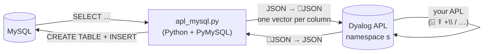

# MySQL ↔ Dyalog APL

Load MySQL query results into APL, analyse them with array operations, and
write the results back to MySQL tables. There are two ways to do it:

| | **From APL**: [apl/](apl/README.md) | **From Python**: this folder |
| --- | --- | --- |
| You write | APL: `db MySQLQuery 'SELECT …'` | Python: `bridge.load("s", "SELECT …")` |
| Runs in | the Dyalog session (SQAPL + ODBC) | Python, which drives Dyalog over RIDE |
| Needs | the `dyalog-mysql` image (adds an ODBC driver) | PyMySQL, and Dyalog serving RIDE |
| Good for | working in APL: RIDE, the terminal, your own `.aplf` code | scripts, Streamlit, pipelines |

The rest of this page covers the **Python** bridge. For the APL functions,
see [apl/README.md](apl/README.md).



## Quick start: the demo

The demo creates a database `apl_demo` with 60 sample sales. It loads them
into APL, runs some analyses, and writes two summary tables back.

```sh
# once
uv pip install --python .venv/bin/python -r integrations/mysql/requirements.txt

# terminal 1: Dyalog serving RIDE
install/dyalog/podman.sh ride

# terminal 2: point it at your MySQL (defaults: 127.0.0.1:3307, user root)
MYSQL_PASSWORD=... .venv/bin/python integrations/mysql/demo.py
```

To use a throwaway MySQL instead of your own:

```sh
podman run -d --rm --name apl-mysql -p 3399:3306 -e MYSQL_ROOT_PASSWORD=demo docker.io/library/mysql:8.4
# wait ~20 s for it to start, then:
MYSQL_PORT=3399 MYSQL_PASSWORD=demo .venv/bin/python integrations/mysql/demo.py
```

What it prints:

```
── Orders and revenue per region  (⌸ key) ──────────────────────
┌─────┬──┬───────┐
│North│14│1604.73│
├─────┼──┼───────┤
│South│18│3152.85│
...
── Revenue per month with running total  (+\ scan) ─────────────
┌───────┬───────┬────────┐
│2026-01│828.69 │828.69  │
│2026-02│2034.37│2863.06 │
...
── Saved region_summary (4 rows) — read back with SQL ──────────
{'orders': 18, 'region': 'South', 'revenue': 3152.85}
...
```

These numbers were checked against the same calculations done in plain SQL.

| Env var | Default | |
| --- | --- | --- |
| `MYSQL_HOST` / `MYSQL_PORT` | `127.0.0.1` / `3307` | |
| `MYSQL_USER` / `MYSQL_PASSWORD` | `root` / *(required)* | |
| `MYSQL_DATABASE` | `apl_demo` | created if missing |
| `DYALOG_HOST` / `DYALOG_PORT` | `localhost` / `4502` | |
| `APL_EXCHANGE` | *(unset)* | `host_dir:container_dir` for fast bulk transfer, see below |

## Using it in your own code

```python
import pymysql
from apl_mysql import AplMySQL          # integrations/mysql
from dyalog_client import DyalogClient  # integrations/dyalog_ride

with DyalogClient() as apl:
    db = pymysql.connect(host="127.0.0.1", port=3307, user="root",
                         password="...", database="apl_demo")
    b = AplMySQL(apl, db)

    b.load("s", "SELECT region, qty*price AS amount FROM sales")  # → s.region, s.amount
    print(b.run("+/s.amount"))                                     # APL → text

    b.run("t←s.region{⍺,(≢⍵),+/⍵}⌸s.amount")                       # group by region
    b.run("r←⎕NS ⍬ ⋄ r.(region orders total)←↓⍉t")                 # columns → namespace
    b.save("region_summary", "r")                                  # → MySQL table

    print(b.get("r"))          # APL → Python: {'region': [...], 'orders': [...], ...}
    print(b.query("SELECT * FROM region_summary"))
```

| Method | What it does |
| --- | --- |
| `load(name, sql, params=None)` | Runs a SELECT and creates an APL namespace with one vector per column (plus `name.columns`). Returns the row count. |
| `run(code)` | Runs APL and returns the output text. Raises `AplError` if the APL fails. |
| `get(expr)` | Evaluates APL and returns Python data (namespace → dict, vector → list, matrix → list of rows, `⎕NULL` → `None`). |
| `put(name, value)` | Sends Python data (dict, list, number or string) to an APL variable. |
| `save(table, expr, mode="replace")` | Writes a namespace of equal-length vectors to a table. `replace` recreates the table with inferred column types; `append` inserts into an existing one. |
| `query(sql, params=None)` | Runs SQL and returns rows as dicts. |

### Type mapping

| MySQL | APL | back to MySQL (`save`, replace mode) |
| --- | --- | --- |
| INT, BIGINT | integers | BIGINT |
| DECIMAL, FLOAT, DOUBLE | floats | DOUBLE |
| VARCHAR, TEXT, CHAR | character vectors (nested) | VARCHAR(255) or TEXT |
| DATE, DATETIME | ISO strings `'2026-03-14'` | VARCHAR |
| NULL | `⎕NULL` (shows as `null`) | NULL |

Column names must be valid APL names, so alias anything else in SQL:
``SELECT `first name` AS first_name``. Table and column names are checked
against `[A-Za-z_][A-Za-z0-9_]*`, and values are always sent as query
parameters, never pasted into SQL text.

## Speed and the fast path

By default, data is typed into the APL session over the RIDE connection,
about 650 characters per line. Dyalog's session rejects longer lines with an
"INPUT LIMIT" dialog. This needs no setup but manages only about
**6 KB/s**: 60 rows take under a second, 5,000 rows about 18 seconds.

For bigger tables, give it a folder that both Python and the container can
see. JSON is then exchanged as files (`⎕NGET` / `⎕NPUT`), and **5,000 rows
load in about 0.04 s**:

```sh
# mount a shared folder when starting Dyalog
mkdir -p /tmp/apl-exchange
podman run -it --rm -p 4502:4502 -e 'RIDE_INIT=SERVE:*:4502' \
  -v /tmp/apl-exchange:/exchange docker.io/dyalog/dyalog

APL_EXCHANGE=/tmp/apl-exchange:/exchange MYSQL_PASSWORD=... \
  .venv/bin/python integrations/mysql/demo.py
```

In code: `AplMySQL(apl, db, exchange=("/tmp/apl-exchange", "/exchange"))`.
Temporary files are deleted after each transfer.

## Notes

- `get()` and `save()` read results with `1(⎕JSON⍠'HighRank' 'Split')`, so
  matrices come back as lists of rows. A namespace whose fields are
  equal-length vectors maps to a table.
- A column of single characters (`'A' 'B'`) comes back from APL as one
  string `"AB"`. `save()` splits it back into separate values.
- The demo connects as `root` for convenience. For real data, create a MySQL
  user with only the permissions it needs.
