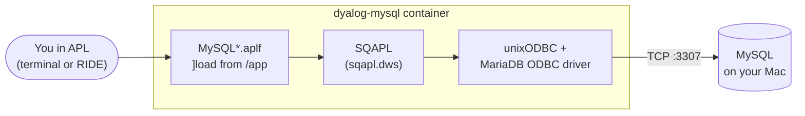

# MySQL from APL (no Python)

APL functions (`.aplf`) that connect to MySQL directly from a Dyalog
session. They use **SQAPL**, Dyalog's built-in ODBC interface
(`ws/sqapl.dws`), with the MariaDB ODBC driver.



| File | Use |
| --- | --- |
| [MySQLConnect.aplf](MySQLConnect.aplf) | `db←MySQLConnect host port database user password` |
| [MySQLQuery.aplf](MySQLQuery.aplf) | `t←db MySQLQuery 'SELECT …'`: a namespace with one vector per column, plus `t.columns` and `t.data` (matrix) |
| [MySQLExec.aplf](MySQLExec.aplf) | `n←db MySQLExec 'INSERT/UPDATE/DELETE/CREATE …'`: returns the number of rows affected |
| [MySQLSave.aplf](MySQLSave.aplf) | `db MySQLSave 'table' ns` writes a namespace of columns to a table (`'append'` as a 3rd item to add rows) |
| [MySQLClose.aplf](MySQLClose.aplf) | `MySQLClose db` |
| [SalesDemo.aplf](SalesDemo.aplf) | the whole demo in APL: seed data, analyse, write results back |
| [Dockerfile](Dockerfile), [build.sh](build.sh) | Dyalog image with the ODBC driver |

## 1. Build the image (once)

The official Dyalog image has SQAPL and unixODBC but no MySQL driver. This
adds Debian's `odbc-mariadb` package, which also works with MySQL 8:

```sh
integrations/mysql/apl/build.sh          # → localhost/dyalog-mysql:latest
```

## 2. Start Dyalog with that image

```sh
IMAGE=localhost/dyalog-mysql:latest install/dyalog/podman.sh run    # APL in the terminal
# or
IMAGE=localhost/dyalog-mysql:latest install/dyalog/podman.sh ride   # for RIDE / Streamlit
```

`podman.sh` mounts this repo at `/app`.

## 3. Use it from APL

```apl
      ]load /app/integrations/mysql/apl/*.aplf
      db←MySQLConnect 'host.containers.internal' 3307 'apl_demo' 'root' 'secret'

      s←db MySQLQuery 'SELECT region, qty*price AS amount FROM sales'
      s.columns
┌──────┬──────┐
│region│amount│
└──────┴──────┘
      s.region{⍺,(≢⍵),+/⍵}⌸s.amount          ⍝ orders and revenue per region
 North  17 3422.87
 South  13 2340.75
 West   13 2611.5
 East   17 3152.1

      ⍝ parameters use SQAPL bind markers :n<type:  (I int, F float, C<n> text)
      p←db MySQLQuery 'SELECT region, qty FROM sales WHERE region=:1<C20: AND qty>:2<I:' 'North' 15

      r←⎕NS ⍬ ⋄ r.(region revenue)←('North' 'South')(3422.87 2340.75)
      db MySQLSave 'my_summary' r            ⍝ creates the table, inserts 2 rows
2
      db MySQLExec 'DELETE FROM my_summary WHERE revenue<3000'
1
      MySQLClose db
```

Or run the full demo, which creates the database `apl_demo` if needed:

```apl
      SalesDemo 'host.containers.internal' 3307 'apl_demo' 'root' 'secret'
Seeded 60 rows into apl_demo.sales
Loaded 60 rows. Columns:  sale_date  region  product  qty  price  amount
Total revenue  (+/s.amount):
11527.22
Orders and revenue per region  (⌸ key):
 North  17 3422.87
 ...
Saved region_summary: 4 rows
Saved monthly_revenue: 6 rows
```

All of the demo's results were checked against the same calculations in
plain SQL.

**Host name:** inside the container, your Mac is `host.containers.internal`
with Podman, or `host.docker.internal` with Docker. Use the port MySQL is
published on (yours is `3307`).

## How values map

| MySQL | APL (from `MySQLQuery`) | written by `MySQLSave` as |
| --- | --- | --- |
| INT | integer | BIGINT (whole numbers) |
| BIGINT, `COUNT(*)` | integer (SQAPL sends text; converted) | BIGINT |
| DECIMAL, DOUBLE | float | DOUBLE |
| VARCHAR, TEXT | character vector (UTF-8 decoded) | VARCHAR(255) or TEXT |
| DATE, DATETIME | text `'2026-03-14'` | VARCHAR |
| NULL | `0` for numbers, `''` for text | |

## Things worth knowing

- **Column names** must be valid APL names, so alias expressions:
  `qty*price AS amount`. Otherwise you get a clear error.
- **Parameters:** use `:1<I:`, `:2<C20:` and so on. Plain `?`
  placeholders don't work with SQAPL here.
- **Connections:** without a name, `MySQLConnect` generates a unique one,
  so you can have several. `'reports' MySQLConnect …` uses your own name
  and replaces an existing connection with that name.
- **Unicode:** SQAPL returns text as UTF-8 bytes, and `MySQLQuery` decodes
  it, so `'Zoë ⍳⍴'` comes back intact. Writing works as is.
- **Speed:** `MySQLSave` inserts one row at a time through a prepared
  statement. That's fine for summaries and small tables. For bulk loads,
  use MySQL's own tools.
- **Errors** are APL errors with MySQL's message, e.g.
  `DOMAIN ERROR: MySQLQuery: … Table 'shop.nosuchtable' doesn't exist`.
- **Password:** it's passed in the connection string. Don't save it in
  files you commit.

The Python bridge in [`..`](../README.md) does the same job from Python
(useful for scripts, Streamlit and the like). These functions are for
working in APL itself.
