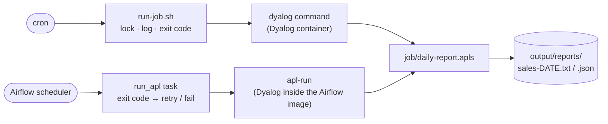

# Scheduling APL jobs: cron and Airflow

Run APL scripts on a schedule, with nobody at the keyboard: an overnight
report, a data load, a reconciliation. There are two ways to schedule them:

| | Use it when | What you get |
| --- | --- | --- |
| **[cron](#cron)** | one machine, a few jobs, nothing depends on anything else | a crontab line, one log file per run, a lock so runs never overlap |
| **[Airflow](#airflow)** | jobs depend on each other, you want retries, history, a UI, backfills | a local Airflow (Docker/Podman compose) with Dyalog inside it, and two example DAGs |

Both run the same, unchanged APL script, and any other `.apls` in the repo.



## What makes an APL script schedulable

A scheduler knows only one thing about your script: its **exit code**.
`0` means it worked; anything else means it failed. By default an APL script
exits with `0` even when it went wrong, so the scheduler reports success.
[job/daily-report.apls](job/daily-report.apls) shows the pattern:

```apl
Main←{
    ~S.Exists in:2⊣'job'L.Error'input not found: ',in     ⍝ bad input → 2
    …
    0                                                     ⍝ done → 0
}
Run←{0::1⊣'job'L.Error Lib.Err.Text ⍬ ⋄ Main ⍵}             ⍝ any other error → 1, logged
code←Run S.Args ⍬
⎕OFF code
```

| Exit code | Meaning | cron | Airflow |
| --- | --- | --- | --- |
| `0` | report written | logged | task succeeds |
| `2` | bad input (missing file, bad date, bad numbers) | logged, error to stderr | fails **without retrying**: it would fail the same way again |
| `1` | anything else | logged, error to stderr | fails, **retried** twice, 2 minutes apart |
| `4` | an error nobody trapped (Dyalog's own code) | same as 1 | same as 1 |

Some things to know about this pattern:

- **Use `code←Run …` then `⎕OFF code`.** Writing `⎕OFF Run S.Args ⍬` quits
  *before* running `Run`, and exits with `0`.
- **In a dfn, write `_←'job'L.Info …`, not just `'job'L.Info …`.** A dfn
  returns at its first statement that isn't an assignment, so a bare log
  call ends `Main` right there.
- **Make reruns harmless.** The job takes the date as an argument and
  overwrites `sales-DATE.*`, so running a day twice gives the same result.
  It writes to a temporary file and renames it, so nothing ever reads a
  half-written report.
- **Log with timestamps.** `Lib.Log` lines show what happened when you look
  later.

Try it by hand first:

```sh
dyalog integrations/scheduling/job/daily-report.apls 2026-11-16      # exit 0
dyalog integrations/scheduling/job/daily-report.apls 2026-02-30      # exit 2: not a date
echo $?
```

```
2026-11-16 21:57:42 INFO  [job] report for 2026-11-16 from /app/integrations/scheduling/job/data/sales.csv
Sales report for 2026-11-16 (Monday)
Generated 2026-11-16 21:57:42 from sales.csv

Orders:        10
Revenue:       $1,135.24
Best seller:   Widget

North      3 orders     $395.81
South      3 orders     $379.66
West       2 orders     $221.85
East       2 orders     $137.92
2026-11-16 21:57:42 INFO  [job] wrote /app/integrations/scheduling/output/reports/sales-2026-11-16.txt and .json
```

Arguments: `daily-report.apls [DATE] [INPUT.csv] [OUTDIR]`. They default to
today, [job/data/sales.csv](job/data/sales.csv), and `output/reports/` (or
`$REPORT_DIR`).

## cron

```sh
C=integrations/scheduling/cron/cron.sh
$C test "integrations/scheduling/job/daily-report.apls"        # run it now, the way cron would
$C add  "0 6 * * *" integrations/scheduling/job/daily-report.apls   # every day at 06:00
$C list
$C remove daily-report
```

`cron.sh add` adds a line like this to your crontab, tagged so `list` and
`remove` touch only the lines it added:

```
0 6 * * * /…/integrations/scheduling/run-job.sh integrations/scheduling/job/daily-report.apls >/dev/null 2>&1 # apl-job:daily-report
```

Any script works: `$C add "*/15 * * * *" sample-scripts/04-primes.apls`.

[run-job.sh](run-job.sh) is what cron actually runs. You can use it from
any other scheduler too (launchd, systemd timers, CI):

- **cron's bare environment:** cron starts jobs with `PATH=/usr/bin:/bin`
  and no terminal. The wrapper adds Homebrew's paths, so `podman`/`docker`
  are found, and uses absolute paths throughout.
- **One log per run:** each run writes `output/logs/<job>-YYYYMMDD-HHMMSS.log`,
  and `<job>-latest.log` points to the newest one. Logs older than
  `KEEP_LOG_DAYS` (14) are deleted.
- **No overlaps:** if the previous run is still going, the new one logs a
  line to `<job>-skipped.log` and exits `0`. A lock left by a killed run
  is taken over.
- **Exit code passed back:** on failure, it prints the last 20 log lines to
  stderr as well. cron mails stderr to you if local mail is set up.

### On a Mac

- **Full Disk Access.** If the repo is under `~/Desktop`, `~/Documents` or
  `~/Downloads`, macOS blocks cron from reading it, and the job fails with
  *Operation not permitted*. Fix it in System Settings → Privacy & Security
  → Full Disk Access → **+** → press ⌘⇧G → `/usr/sbin/cron`. Or keep the
  repo somewhere else. `cron.sh add` warns you about this.
- **The Mac must be awake.** cron skips runs that fall while the Mac sleeps.
  launchd (`~/Library/LaunchAgents`) runs them on wake instead; point its
  `ProgramArguments` at `run-job.sh` in the same way.
- **Podman's VM.** The `dyalog` command starts `podman machine` if it isn't
  running, but the first run after a reboot is slower.

### Times and dates

cron uses your Mac's local time; the Dyalog container runs on UTC. So a job
at 23:30 New York time finds "today" (UTC) is already tomorrow. When the
date matters, pass it explicitly. In a crontab, `%` must be written `\%`:

```
30 23 * * * /…/run-job.sh integrations/scheduling/job/daily-report.apls $(date +\%F)
```

## Airflow

A local Airflow 3 in two containers (Postgres and `airflow standalone`). It
uses an image that is the official Airflow image with Dyalog copied in, so a
task runs APL directly. There's no container-in-container and no Docker
socket.

```sh
A=integrations/scheduling/airflow/airflow.sh
$A up                              # first time: builds the image (~2 min), then ~1 min to start
open http://localhost:8088         # no login: it's bound to 127.0.0.1, for local use only
$A trigger apl_daily_report        # run now and wait for the result
$A trigger apl_daily_report '{"date": "2026-11-01"}'    # a particular day
$A trigger apl_sample_scripts      # every sample script, in parallel
$A status
$A down                            # stop; run history is kept (reset deletes it)
```

| File | What it is |
| --- | --- |
| [airflow/Dockerfile](airflow/Dockerfile) | `apache/airflow:3.4.0` + `/opt/mdyalog` from `dyalog/dyalog` (both Debian 13; Dyalog needs only libc) |
| [airflow/apl-run](airflow/apl-run) | `dyalogscript` with clean line endings and its exit code kept |
| [airflow/docker-compose.yaml](airflow/docker-compose.yaml) | Postgres + Airflow; mounts the repo read-only at `/apl` and `output/` at `/apl-output` |
| [airflow/dags/apl_tasks.py](airflow/dags/apl_tasks.py) | `run_apl`: the task that runs a script and turns its exit code into succeed / fail / retry |
| [airflow/dags/apl_daily_report.py](airflow/dags/apl_daily_report.py) | daily at 06:00 UTC: `run_date`, `check_input` → `report` (APL) → `summary` (Python reads the APL's JSON) |
| [airflow/dags/apl_sample_scripts.py](airflow/dags/apl_sample_scripts.py) | manual: one task per `sample-scripts/NN-*.apls`, all in parallel |

Running APL from your own DAG takes one line:

```python
from apl_tasks import run_apl

run_apl.override(task_id="primes")("sample-scripts/04-primes.apls")
```

Arguments can be other tasks' results (as `check_input` → `report` does)
or templates. Each task's log in the UI shows the script's output.

Good to know:

- **A DAG starts paused.** `airflow.sh trigger` unpauses it. Once unpaused,
  `apl_daily_report` immediately runs the most recent 06:00 it missed
  (`catchup=False` means only that one, not every day since `start_date`).
- **Manual runs have no logical date** in Airflow 3, so `{{ ds }}` doesn't
  work for them. `run_date` uses the `date` param if given, else the
  scheduled date, else the time you triggered it.
- **Reports from both schedulers land in the same place,**
  `integrations/scheduling/output/reports/`, which git ignores.
- **Ports:** the UI is on 8088, so it doesn't clash with Jarvis on 8080.
  Change it with `AIRFLOW_PORT`.
- **This isn't a production setup:** it has no login, uses a single
  container, and stores the Postgres password in the compose file. For a
  real deployment, use Airflow's official Helm chart or compose file and
  bake the Dyalog layer from this Dockerfile into your image.
  The licence for Dyalog in the image is the same as for `dyalog/dyalog`
  (free for non-commercial use).

## Files

```
scheduling/
├── job/daily-report.apls    the APL job (exit codes, logging, safe reruns)
├── job/data/sales.csv       its input
├── run-job.sh               cron-safe wrapper for any .apls
├── cron/cron.sh             add / list / remove / test crontab entries
├── airflow/                 Dockerfile, compose, airflow.sh, dags/
└── output/                  reports/ and logs/ (git-ignored)
```
