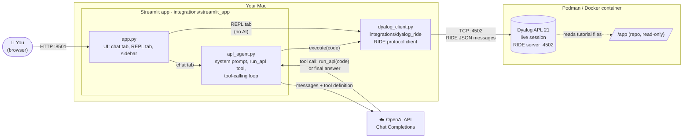
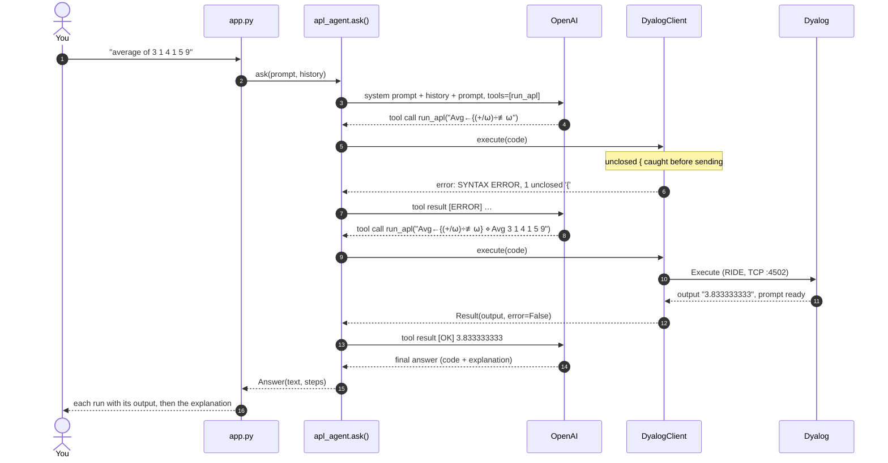

# APL Playground (Streamlit)

A web UI for Dyalog APL with two tabs:

- **💬 Ask in English.** Describe what you want ("make a 5×5 multiplication
  table"). An OpenAI model writes APL, runs it in Dyalog, reads any error
  and retries, then explains the answer. You see every piece of code it ran
  and the real output.
- **⌨️ APL REPL.** Type APL yourself, with clickable glyph buttons. This tab
  uses no AI and costs nothing.

Both tabs share one live Dyalog session, so a function defined in the chat
can be used in the REPL, and the other way round. Follow-up questions work
too ("now do it for 1 to 1000").

## Run it

```sh
# once: create a virtual environment and install dependencies
uv venv .venv
uv pip install --python .venv/bin/python -r integrations/streamlit_app/requirements.txt
# (or: python3 -m venv .venv && .venv/bin/pip install -r integrations/streamlit_app/requirements.txt)

# terminal 1: Dyalog serving RIDE on port 4502
install/dyalog/podman.sh ride

# terminal 2: the app
export OPENAI_API_KEY=sk-...          # or paste it into the sidebar
.venv/bin/streamlit run integrations/streamlit_app/app.py
```

Open <http://localhost:8501> and click **Connect**. If Dyalog isn't running,
**Start container** launches one with the repo mounted read-only at `/app`.

## Settings (sidebar)

| Setting | Default | Notes |
| --- | --- | --- |
| Host / Port | `localhost` / `4502` | where Dyalog serves RIDE |
| API key | `$OPENAI_API_KEY` | only kept in memory for your browser session |
| Model | `$OPENAI_MODEL` or `gpt-4.1-mini` | any Chat Completions model that supports tool calling |
| Max APL runs | 5 | how many times the model may run code per question |

**Reset session** clears all APL variables and the chat. **Clear chat**
keeps the APL session but starts a new conversation.

## Architecture



| Component | File | Responsibility |
| --- | --- | --- |
| UI | [app.py](app.py) | Draws the tabs and sidebar, keeps per-browser state (`st.session_state`): the Dyalog connection, the chat history, the REPL log |
| Agent | [apl_agent.py](apl_agent.py) | Sends your request to OpenAI with one tool, `run_apl`. Runs the code the model asks for and feeds results back, up to *Max APL runs* times. Works without Streamlit. |
| Dyalog client | [../dyalog_ride/dyalog_client.py](../dyalog_ride/README.md) | Holds one live APL session over TCP. Handles errors, timeouts, multi-line code and input prompts. |
| Dyalog | container `dyalog/dyalog` | Runs the APL. The repo is mounted read-only at `/app`. |

## Request flow

What happens when you ask *"average of 3 1 4 1 5 9"* in the chat tab, here
with the model making a mistake on its first try:



In the **REPL tab**, steps 2–17 are replaced by a single
`DyalogClient.execute()` call. No OpenAI request is made.

### The loop in `apl_agent.ask()`

```mermaid
flowchart TD
    start([user prompt]) --> call[Call OpenAI with history + run_apl tool]
    call --> q{Model asked<br/>to run code?}
    q -- no --> done([Return answer + steps])
    q -- yes --> run[DyalogClient.execute code]
    run --> res[Append result to history:<br/>OK / ERROR / TIMED OUT + output]
    res --> limit{Reached<br/>Max APL runs?}
    limit -- no --> call
    limit -- yes --> final[Ask for a final answer<br/>tool_choice = none]
    final --> done
```

### State

| What | Where it lives | Cleared by |
| --- | --- | --- |
| APL variables and functions | the Dyalog session (container) | **Reset session** |
| Conversation with the model | `st.session_state.llm_history` | **Clear chat** or **Reset session** |
| Dyalog connection | `st.session_state.apl` (one per browser tab) | **Disconnect** |

The chat and the REPL share the same Dyalog session, so whatever one
defines, the other can use.

## Costs and safety

- The chat tab calls the OpenAI API, which is billed per token. Each
  question is a few calls, one per APL run plus the answer. The REPL tab is
  free.
- The model's code runs inside the Dyalog container. Use **Start container**,
  which mounts read-only, or start your own container with a read-only
  mount. The system prompt tells the model not to use `⎕SH` or write files,
  but the container is the real safeguard.
- `⎕`/`⍞` input isn't supported. If code asks for input, the request is
  cancelled.
